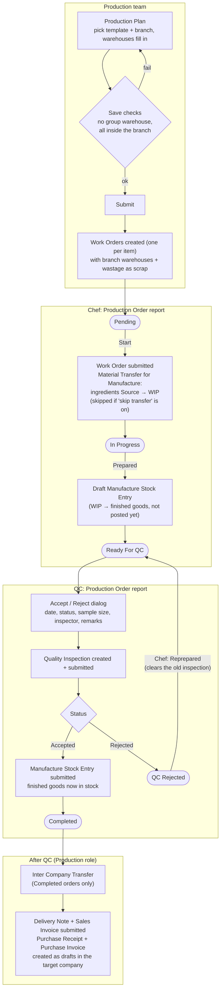

# Production Planner: how it works

A quick summary of the app, from planning production to the chef cooking and QC signing off.

## In one paragraph

The **Production** team builds a **Production Plan**, usually from a template, for a branch.
Submitting it creates one **Work Order** per item. The **Chef** works those orders from the
**Production Order** report: **Start** moves ingredients to WIP, and **Prepared** books the
finished goods as a draft Manufacture entry. **QC** then accepts or rejects each order. Accept
posts the stock and completes the order. Reject sends it back to the chef to re-prepare.
Completed orders can be sent to another company with an **Inter Company Transfer**.

## Who does what

| Role | Workspace | Main screens |
|---|---|---|
| Production | Production Panel | Production Plan, Production Plan Template, Production Branch Warehouse, Stock Entry, Recipe (BOM), Item, reports |
| Chef | Chef's Panel | Production Order report, Recipe (BOM) and Recipe Search, Production Summary / Overview |
| QC | QC Panel | Production Order report, Quality Inspection (accepted / rejected), Production Quality Summary |

## End-to-end flow

## Work Order states

| State | Who moves it on | Button in Production Order | What happens to stock |
|---|---|---|---|
| Pending | Chef | Start | Ingredients move Source → WIP (unless skip transfer) |
| In Progress | Chef | Prepared | Draft Manufacture entry created, not yet posted |
| Ready For QC | QC | Accept / Reject | Accept: Manufacture entry posted. Reject: nothing posted |
| QC Rejected | Chef | Reprepared | Back to Ready For QC on the same draft entry |
| Completed | Production | Inter Company Transfer | Goods leave the finished goods warehouse on the Delivery Note |

These states come from the **Work Order Flow** workflow (`fixtures/workflow.json`). The
buttons call `handle_action` and `create_quality_inspection` in
`report/production_order/production_order.py`.

## Side flows

- **Extra consumption**: ingredients used beyond the recipe are booked as *Material
  Consumption for Manufacture* Stock Entries with a **Consumption Reason**. The
  **Extra Consumption** report lists them by reason.
- **Wastage**: a *Wastage Entry* Stock Entry type lets you edit the basic rate and fills the
  expense account from the company's **Stock Wastage Account**
  (`overrides/stock_entry.py`, `public/js/stock_entry.js`).
- **Group-warehouse guard**: Start, Prepared and QC Accept all check the Stock Entry for
  group warehouses first, so the error names the field to fix instead of failing at the
  QC click.

## Reports and dashboard

| Report | Shows |
|---|---|
| Production Order | The working screen for chef and QC: orders, status, action buttons, transfer |
| Production Summary / Production Overview | Work Order totals and trends |
| Production Quality Summary | QC accepted vs rejected |
| Extra Consumption | Extra ingredient use by reason |

The **Production** dashboard has number cards for orders, completed and pending quantity,
QC accepted and rejected, and orders that need re-preparing.

For details on how branches pick and check warehouses, see
[Production Plan: branch warehouse flow](production_plan_flow.md).
