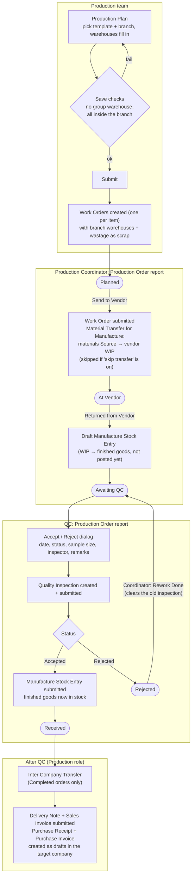

# Production Planner: how it works

A quick summary of the app, from planning production to the vendor returning the goods and QC signing off.
For the step-by-step maceration and copack guide, see [Vendor flow](vendor_flow.md).

## In one paragraph

The **Production** team builds a **Production Plan**, usually from a template, for a branch.
Submitting it creates one **Work Order** per item. The **Production Coordinator** works those orders from the
**Production Order** report: **Send to Vendor** moves materials to the vendor's WIP, and **Returned from Vendor** books the
finished goods as a draft Manufacture entry. **QC** then accepts or rejects each order. Accept
posts the stock and completes the order. Reject sends it back to the vendor for rework.
Completed orders can be sent to another company with an **Inter Company Transfer**.

## Who does what

| Role | Workspace | Main screens |
|---|---|---|
| Production | Production Panel | Production Plan, Production Plan Template, Production Branch Warehouse, Stock Entry, BOM, Item, reports |
| Production Coordinator | Production Tracking | Production Order report, Vendor Tracker, BOM and BOM Search, Production Summary / Overview |
| QC | QC Panel | Production Order report, Quality Inspection (accepted / rejected), Production Quality Summary |

## End-to-end flow

## Work Order states

| State | Who moves it on | Button in Production Order | What happens to stock |
|---|---|---|---|
| Planned (Pending) | Production Coordinator | Send to Vendor | Materials move Source → vendor WIP (unless skip transfer); Sent On and Expected Ready set |
| At Vendor (In Progress) | Production Coordinator | Returned from Vendor | Draft Manufacture entry created, not yet posted |
| Awaiting QC (Ready For QC) | QC | Accept / Reject | Accept: Manufacture entry posted, Received On and Actual Days set. Reject: nothing posted |
| Rejected (QC Rejected) | Production Coordinator | Rework Done | Back to Awaiting QC on the same draft entry |
| Received (Completed) | Production | Inter Company Transfer | Goods leave the finished goods warehouse on the Delivery Note |

Labels show first; the workflow state name is in brackets. These states come from the **Work Order Flow** workflow (`fixtures/workflow.json`). The
buttons call `handle_action` and `create_quality_inspection` in
`report/production_order/production_order.py`.

## Side flows

- **Extra consumption**: materials used beyond the BOM are booked as *Material
  Consumption for Manufacture* Stock Entries with a **Consumption Reason**. The
  **Extra Consumption** report lists them by reason.
- **Wastage**: a *Wastage Entry* Stock Entry type lets you edit the basic rate and fills the
  expense account from the company's **Stock Wastage Account**
  (`overrides/stock_entry.py`, `public/js/stock_entry.js`).
- **Group-warehouse guard**: Send to Vendor, Returned from Vendor and QC Accept all check the Stock Entry for
  group warehouses first, so the error names the field to fix instead of failing at the
  QC click.

## Reports and dashboard

| Report | Shows |
|---|---|
| Production Order | The working screen for the coordinator and QC: orders, status, action buttons, transfer |
| Vendor Tracker | Each vendor job against its BOM lead time: expected ready, overdue, actual days |
| Production Summary / Production Overview | Work Order totals and trends |
| Production Quality Summary | QC accepted vs rejected |
| Extra Consumption | Extra material use by reason |

The **Production** dashboard has number cards for orders, completed and pending quantity,
QC accepted and rejected, and orders that need rework.

For details on how branches pick and check warehouses, see
[Production Plan: branch warehouse flow](production_plan_flow.md).
