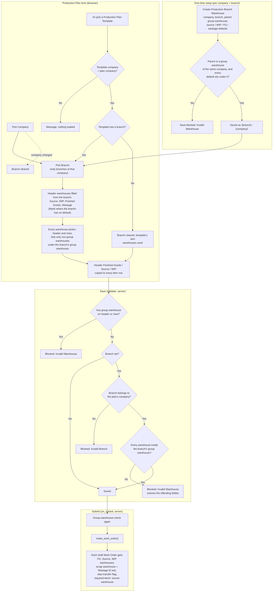
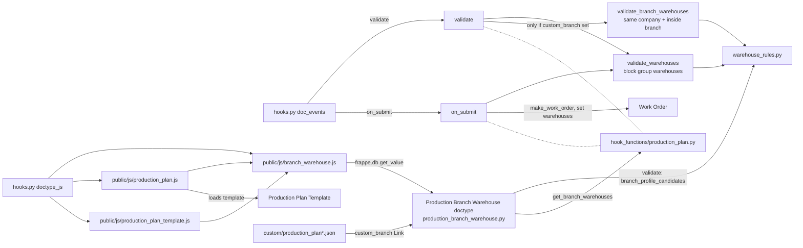

# Production Plan: branch warehouse flow

How the Production Plan customization picks, limits and checks warehouses per branch,
and how those warehouses reach the Work Orders.

## 1. What happens, step by step

## 2. Which file does what

## 3. Field mapping

| Production Plan header field | Comes from Production Branch Warehouse | Ends up on |
|---|---|---|
| `custom_source_warehouse` | `source_warehouse` | item rows, Work Order `source_warehouse`, required items |
| `custom_wip_warehouse` | `wip_warehouse` | item rows, Work Order `wip_warehouse` |
| `custom_finished_goods_warehouse` | `fg_warehouse` | item rows (`warehouse`), Work Order `fg_warehouse` |
| `custom_wastage_warehouse` | `wastage_warehouse` | Work Order `scrap_warehouse` |
| `custom_branch_warehouse` (read-only) | `parent_warehouse` | limits every warehouse picker |

The browser-side filters only make picking easier. The checks that actually stop a wrong
warehouse are the server-side ones in `hook_functions/production_plan.py` and
`warehouse_rules.py`.
