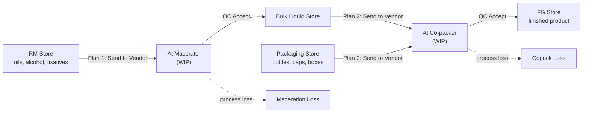

# Vendor flow: from Production Plan to finished goods

How to run perfume production with outside vendors in this app. You own the stock the whole
time. Each vendor does one stage:

1. **Maceration.** Raw materials go to the macerator and come back as **bulk liquid**.
2. **Copack.** Bulk liquid and packaging go to the co-packer and come back as the **finished
   product**.

Each stage is one **Production Plan**. Every step moves stock, so at any moment you can see
what is in your stores, what is at each vendor, and what was lost.



## Who does what

| Role | Workspace | Does |
|---|---|---|
| Production | Production Panel | Sets up vendors, items and BOMs; creates and submits Production Plans |
| Production Coordinator | Production Tracking | Clicks **Send to Vendor**, **Returned from Vendor** and **Rework Done**; watches the Vendor Tracker |
| QC | QC Panel | **Accepts** or **rejects** what the vendor returns |

The Production Coordinator was called *Chef* before. Existing users keep their access, because a
patch renames the role on `bench migrate`.

## 1. One-time setup

### 1.1 Warehouses

Put all your stores and the vendors' WIP warehouses under **one group warehouse**. A plan only
accepts warehouses inside its vendor's group, and copack takes bulk liquid from the store that
maceration fills.

```
Nscent Production - N        (group)
 ├─ RM Store - N             raw materials (oils, alcohol, fixatives)
 ├─ Packaging Store - N      bottles, pumps, caps, labels, boxes
 ├─ Bulk Liquid Store - N    macerated liquid, back from the macerator
 ├─ FG Store - N             finished product, back from the co-packer
 ├─ At Macerator A - N       WIP: your stock sitting at the macerator
 ├─ At Co-packer B - N       WIP: your stock sitting at the co-packer
 ├─ Maceration Loss - N      evaporation, filtration loss
 └─ Copack Loss - N          filling spillage, broken bottles
```

The "At …" warehouses still belong to you. Moving stock there takes it out of your usable
stores without taking it off your books.

### 1.2 Vendor sites

1. **Setup → Branch**: create one Branch per vendor, e.g. `Macerator A` and `Co-packer B`.
2. **Production Panel → Vendor Warehouse Setup** (the *Production Branch Warehouse* list): create
   one record per vendor.

| Field | Macerator A | Co-packer B |
|---|---|---|
| Company | your company | your company |
| Vendor Site | Macerator A | Co-packer B |
| Vendor Group Warehouse | Nscent Production - N | Nscent Production - N |
| Source Warehouse | RM Store - N | Bulk Liquid Store - N |
| Work-in-Progress Warehouse | At Macerator A - N | At Co-packer B - N |
| Finished Goods Warehouse | Bulk Liquid Store - N | FG Store - N |
| Wastage Warehouse | Maceration Loss - N | Copack Loss - N |

### 1.3 Items

| Item | Example | Stock UOM | Notes |
|---|---|---|---|
| Raw materials | `OIL-OUD`, `ALC-96` | ml or g | Batch tracking recommended |
| Bulk liquid | `OUD-NOIR-BULK` | ml | **Has Batch No** on, so each maceration batch is traceable |
| Packaging | `BTL-50`, `CAP-50`, `BOX-50` | Nos | |
| Finished product | `OUD-NOIR-50ML` | Nos | Batch tracking recommended |

### 1.4 BOMs

You need two BOMs per fragrance.

**Maceration BOM** for `OUD-NOIR-BULK`: quantity 1000 ml.

| Component | Qty | Source Warehouse (optional) |
|---|---|---|
| OIL-OUD | 200 ml | |
| ALC-96 | 780 ml | |
| FIX-01 | 20 ml | |

Set **Lead Time (Days)** to how long maceration takes, e.g. **21**.

**Copack BOM** for `OUD-NOIR-50ML`: quantity 1.

| Component | Qty | Source Warehouse |
|---|---|---|
| OUD-NOIR-BULK | 50 ml | Bulk Liquid Store - N |
| BTL-50 | 1 | Packaging Store - N |
| CAP-50 | 1 | Packaging Store - N |
| BOX-50 | 1 | Packaging Store - N |

Set **Lead Time (Days)** to the co-packer's turnaround, e.g. **7**.

When a BOM line has its own **Source Warehouse**, that line is drawn from there. Otherwise the
plan's Source Warehouse is used. That is how one copack job pulls liquid and packaging from two
different stores.

> Keep "Inspection Required" on (it is the default here), so QC must accept before stock is booked.

### 1.5 Templates (optional)

**Production Plan Template** saves a repeat run: company, **Process Type**, vendor site and items.
Choosing a template on a plan fills all of these in.

## 2. Stage 1: Maceration plan

1. **Production Plan → New**
   - **Company**
   - **Process Type**: `Maceration`
   - **Vendor Site**: `Macerator A`. The Source, WIP, Finished Goods and Wastage warehouses fill in.
   - **Items**: `OUD-NOIR-BULK`, Planned Qty `10000` (ml). The BOM is picked automatically.
2. **Save.** The **Materials to Send** table fills from the BOM:

   | Item | Source Warehouse | Required | Available | Shortage |
   |---|---|---|---|---|
   | OIL-OUD | RM Store - N | 2000 | 2500 | 0 |
   | ALC-96 | RM Store - N | 7800 | 6000 | **1800** |
   | FIX-01 | RM Store - N | 200 | 500 | 0 |

   Fix any shortage first (buy or transfer stock in), then save again. The table refreshes on
   every save.
3. **Submit.** One **Work Order** is created per item. Each Work Order carries the process type,
   the vendor site and the BOM's lead time.

### Moving the job along

Open **Production Order** (or **Vendor Tracker** to watch dates).

| Status | Button | Who | Stock | Timer |
|---|---|---|---|---|
| **Planned** | **Send to Vendor** | Production Coordinator | RM Store → At Macerator A | **Sent On** = today, **Expected Ready** = today + lead time |
| **At Vendor** | **Returned from Vendor** | Production Coordinator | Draft receipt, nothing posted yet | |
| **Awaiting QC** | **Accept** / **Reject** | QC | Accept: At Macerator A → Bulk Liquid Store, loss → Maceration Loss | Accept: **Received On**, **Actual Days** |
| **Rejected** | **Rework Done** | Production Coordinator | Stock stays at the vendor | Back to Awaiting QC |
| **Received** | | | Bulk liquid is in stock | |

If the vendor gives a new date, edit **Expected Ready** on the Work Order (Vendor Timing section).

**Extra materials:** if the vendor used more than the BOM, book a *Material Consumption for
Manufacture* Stock Entry with a **Consumption Reason**. It shows up in **Extra Consumption**.

## 3. Stage 2: Copack plan

Start this once the bulk liquid is **Received** and sitting in Bulk Liquid Store.

1. **Production Plan → New**
   - **Process Type**: `Copack`
   - **Vendor Site**: `Co-packer B`
   - **Items**: `OUD-NOIR-50ML`, Planned Qty `200`
2. **Save.** The **Materials to Send** table now lists:

   | Item | Source Warehouse | Required |
   |---|---|---|
   | OUD-NOIR-BULK | Bulk Liquid Store - N | 10000 ml |
   | BTL-50 | Packaging Store - N | 200 |
   | CAP-50 | Packaging Store - N | 200 |
   | BOX-50 | Packaging Store - N | 200 |

3. **Submit**, then follow the same buttons as Stage 1:
   **Send to Vendor → Returned from Vendor → QC Accept**.
   Accepting books the finished product into **FG Store**.

## 4. Tracking and forecasting

**Vendor Tracker** (on the Production Tracking and Production Panel workspaces) lists every
vendor job.

| Column | Meaning |
|---|---|
| Sent On / Expected Ready | When the job left, and when it should be back |
| Days Left | Negative means late |
| Actual Days | How long it really took (after QC Accept) |
| Avg Actual Days | Average of past jobs for the same BOM at the same vendor |
| Timing | Not Sent · No Lead Time · On Track · Due Soon (≤ 7 days) · Overdue · Received On Time · Received Late |

The cards at the top count Overdue, Due Soon, On Track, Received On Time and Received Late.
Untick **Open Jobs Only** to see history.

**Forecasting:** when **Avg Actual Days** keeps differing from the BOM's **Lead Time**, update
the Lead Time on the BOM. New jobs then get a more accurate Expected Ready date. To plan
backwards from a launch date:

```
copack send date     = launch date − copack lead time
maceration send date = copack send date − maceration lead time
```

## 5. Where stock sits at each moment

| Moment | RM Store | At Macerator | Bulk Liquid | Packaging | At Co-packer | FG Store |
|---|---|---|---|---|---|---|
| Before | oils, alcohol | | | bottles, caps | | |
| Maceration sent | − | + | | | | |
| Maceration accepted | | − | + | | | |
| Copack sent | | | − | − | + | |
| Copack accepted | | | | | − | + |

Use **Stock Balance** filtered by the "At …" warehouses to see everything currently at vendors.

## 6. Name changes from the restaurant version

| Before | Now |
|---|---|
| Chef (role) / Chef's Panel | Production Coordinator / Production Tracking |
| Branch | Vendor Site |
| Production Branch Warehouse | Vendor Warehouse Setup (same DocType, relabelled) |
| Recipe / Recipe Search | BOM / BOM Search |
| Start / Prepared / Reprepared | Send to Vendor / Returned from Vendor / Rework Done |
| Pending / In Progress / Ready For QC / QC Rejected / Completed | Planned / At Vendor / Awaiting QC / Rejected / Received |
| Needs To Reprepare (card) | Needs Rework |

Under the hood, the Work Order workflow keeps its original state names. Those Workflow State
records are shared with other ERPNext workflows, so only the labels you see changed.

## 7. Troubleshooting

| Message | Fix |
|---|---|
| *Invalid Warehouse … only allows warehouses under …* | Pick a warehouse inside the vendor's group (section 1.1) |
| *Group node warehouse is not allowed* | Pick a child warehouse, not the group |
| Materials table is empty | The item row has no BOM, or the BOM has no components. Check the BOM and save again |
| Expected Ready is blank | The BOM has no Lead Time. Set it on the BOM; for jobs already sent, type the date on the Work Order |
| Buttons missing on Production Order | The user needs the **Production Coordinator** role (Send/Returned/Rework) or **QC** (Accept/Reject) |
